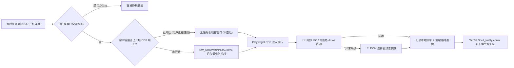

<div align="center">

# 🚀 AI-Agent-Daily-Checkin

**国内主流 AI Coding / Agent 桌面客户端（MiniMax Code · WorkBuddy · TRAE CN）每日自动签到领积分工具**

[](https://www.python.org/)
[](https://playwright.dev/)
[](#)
[](./LICENSE)

*零视觉 Token 消耗 · 不抢占鼠标焦点 · 无视弹窗遮挡 · 原生 Win32 通知免杀软误报*

</div>

---

## 💡 为什么做这个项目？

国内多款优秀的 AI 编程与桌面助手（如 **MiniMax Code**、**WorkBuddy**、**TRAE CN**）提供了慷慨的「每日签到送免费积分 / Credits」福利。但每天手动打开三四个客户端挨个找入口点击非常繁琐，一旦忘记还会断签错失满签大奖。

如果使用基于多模态视觉大模型的 `Computer Use`（截屏 $\rightarrow$ VLM 识别坐标 $\rightarrow$ 模拟鼠标点击）来签到：
- ❌ **算力倒挂**：每次截屏调用视觉模型的 Token 成本甚至高于领到的积分价值；
- ❌ **抢占焦点**：执行时会强行把窗口置顶并抢走你正在写代码的鼠标；
- ❌ **脆弱易断**：遇到版本更新弹窗、活动海报遮挡或分辨率变化极易点偏。

**本项目采用更优雅的工程解法**：由于这些客户端 **100% 基于 Electron（Chromium 内核）构建**，我们直接通过 **CDP（Chrome DevTools Protocol）** 挂载进渲染进程，**在内存里直接调用客户端内置的已鉴权 IPC 通道或带签名 Axios 实例完成签到**，全程无需移动鼠标、无惧任何弹窗遮挡！

---

## ✨ 核心特性

- 🎯 **L1 内部协议直调 + L2 DOM 按钮兜底**：
  - 优先在渲染进程内直接调用应用原生签到方法（`Webpack 内部 Axios` / `Preload IPC` / `VSCode Sandbox IPC`），即使界面被更新弹窗遮挡也能 100% 签到成功。
  - 若未来版本内部函数签名变更，自动降级为 Playwright DOM 选择器点击兜底。
- 👻 **零打扰后台运行（Non-Disruptive）**：
  - **未打开软件时**：通过 Windows `SW_SHOWMINNOACTIVE` 标志在后台最小化拉起，**绝不抢占你当前写代码的键盘与鼠标焦点**，4~6 秒签完即自动清理进程树，零内存驻留。
  - **正在使用软件时**：安装脚本自动为桌面快捷方式注入调试端口，定时任务触发时**直接无感附着到你正在使用的窗口**，0.5 秒领完积分，**绝不关闭或重启你正在干活的软件**。
- ⚡ **0.001 秒防重复秒退**：
  - 每日签到状态与积分明细自动持久化至本地 `logs/checkin_history.json`，当天已全部签过时再次触发（如开机自启复查）会在 `0.001 秒` 内静默退出。
- 🛡️ **火绒 / 杀软 100% 绿通（纯 Win32 原生通知）**：
  - 摒弃常见的 `powershell -WindowStyle Hidden` 弹窗方式，改用 Python 标准库 `ctypes` 直接调用 Windows 底层 `shell32.Shell_NotifyIconW` API 发送右下角系统托盘气泡通知，**绝不触发火绒安全「隐藏执行 PowerShell」拦截报警**。
- 🔍 **跨盘符自动寻路**：
  - 自动扫描 `C/D/E/F/G` 盘与系统环境变量定位客户端安装路径，无需手动修改代码路径，克隆即用。

---

## 🛠️ 技术原理拆解



### 各客户端逆向通道一览

| 客户端 | 默认调试端口 | L1 内部直调通道（主力） | L2 DOM 选择器（兜底） |
| :--- | :---: | :--- | :--- |
| **MiniMax Code** | `19221` | 通过 `window.webpackChunk_N_E` 提取内置带签名拦截器的 Axios 实例（模块 `98304`），自动携带 `yy` / `x-signature` 调 `POST /minimax-cloud/api/v1/signin/claim` | `button.signin-claim-button` |
| **WorkBuddy** | `19222` | 调用 Preload 暴露的 `window.__wbInvoke('auth:getCheckinStatus')` 与 `window.__wbInvoke('auth:claimDailyCheckin')` | `button:has-text('立即领取')` |
| **TRAE CN** | `19223` | 调用 `window.vscode.ipcRenderer.invoke('vscode:sandbox::main-invoke-claimCheckinCredits', 'account_menu')` 并自动检测参与 `participateCheckinLottery` 抽奖 | 账号菜单签到入口 |

---

## 🚀 快速开始

### 1. 环境准备

确保已安装 **Python 3.10+**，并且三个客户端已在本地登录过账号。

```bash
git clone https://github.com/iii765/AI-Agent-Daily-Checkin.git
cd AI-Agent-Daily-Checkin

# 安装轻量依赖（仅需 playwright 协议库与 httpx，无需下载完整浏览器内核）
pip install -r requirements.txt
```

### 2. 手动一键体验

直接双击仓库根目录下的 **[`一键签到.bat`](./一键签到.bat)**，或运行命令：

```powershell
python auto_checkin.py --force
```

终端输出示例：
```text
2026-11-04 00:05:02 [INFO] ========== 开始执行每日自动签到 (2026-11-04) ==========
2026-11-04 00:05:12 [INFO] [MiniMax Code] 刚刚签到成功！获得积分: +400 (通道: L1_WEBPACK_API)
2026-11-04 00:05:25 [INFO] [WorkBuddy] 刚刚签到成功！获得积分: +100 (通道: L1_WB_IPC)
2026-11-04 00:05:38 [INFO] [TRAE CN] 刚刚签到成功！获得积分: +200 (通道: L1_VSCODE_IPC)
2026-11-04 00:05:38 [INFO] ========== 签到汇总 ==========
✅ MiniMax Code: 刚刚签到成功 (+400 积分)
✅ WorkBuddy: 刚刚签到成功 (+100 积分)
✅ TRAE CN: 刚刚签到成功 (+200 积分)
```

### 3. 开启全自动无人值守（推荐）

双击运行 **[`开启每日自动签到.bat`](./开启每日自动签到.bat)**（或执行 `powershell -ExecutionPolicy Bypass -File setup_schedule.ps1`），脚本会自动完成三件事（无需管理员权限）：

1. **注册每日凌晨 `00:05` 定时任务**（`AgentAppsDailyCheckin`）：适合夜猫子开发者，跨过零点自动领完新一天的积分。
2. **创建开机登录自启快捷方式**：如果你头天晚上关机睡觉了，第二天开机登录 Windows 时会自动检测并补签；若凌晨 `00:05` 已签过，开机检测会在 `0.001 秒` 内无感跳过。
3. **为桌面快捷方式注入调试端口**：让你平时手动打开客户端写代码时自带 CDP 端口，半夜 `00:05` 签到时直接无感附着，绝不重启你的编辑器窗口。

---

## ⚙️ 高级用法与自定义

### 命令行参数

```powershell
# 默认模式：仅对今日尚未签到的客户端执行签到（已签过的 0.001 秒秒退）
python auto_checkin.py

# 强制模式：忽略今日本地缓存，强制拉起所有客户端复查签到状态并弹出通知
python auto_checkin.py --force

# 指定单个客户端运行
python auto_checkin.py --app minimax_code --force
python auto_checkin.py --app workbuddy --force
python auto_checkin.py --app trae_cn --force
```

### 自定义客户端安装路径

程序默认会自动搜索 `C:/D:/E:/F:/G:` 盘下的标准安装路径。如果你的客户端安装在非常规目录，可通过环境变量指定：

```powershell
$env:CHECKIN_EXE_MINIMAX_CODE = "D:\CustomPath\MiniMax Code\MiniMax Code.exe"
$env:CHECKIN_EXE_WORKBUDDY    = "D:\CustomPath\WorkBuddy\WorkBuddy.exe"
$env:CHECKIN_EXE_TRAE_CN      = "D:\CustomPath\Trae CN\Trae CN.exe"
```

---

## 📂 目录结构

```text
├── auto_checkin.py        # 核心双层签到引擎（CDP + 内部 IPC/RPC + Win32 原生通知）
├── setup_schedule.ps1     # 自动化计划任务、开机自启与快捷方式端口注入脚本
├── 一键签到.bat            # 手动双击立即签到 / 强制复查入口
├── 开启每日自动签到.bat     # 双击一键配置每日定时任务
├── requirements.txt       # Python 依赖声明
├── logs/                  # 运行日志与每日签到积分账单（已被 .gitignore 忽略，保护隐私）
│   ├── checkin.log
│   └── checkin_history.json
└── README.md
```

---

## 📄 开源协议

本项目基于 [MIT License](./LICENSE) 开源，仅供个人学习与效率提升使用。
